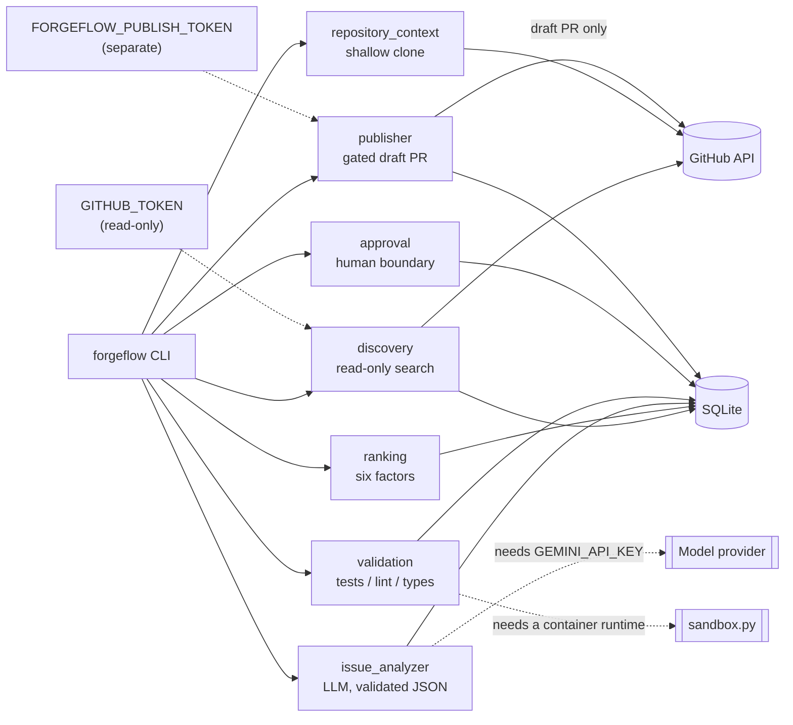

# ForgeFlow

ForgeFlow is a local-first, human-in-the-loop assistant for contributing to open
source. It finds suitable GitHub issues, ranks them, analyses the strongest
candidates with an LLM, drives a coding agent to implement a fix in isolation,
runs the target repository's own quality checks, and prepares a draft pull
request for **explicit human approval**. It never auto-merges, never force-pushes,
and never writes to GitHub without a recorded approval bound to the exact patch.

## Why it exists

Contributing to open source is repetitive work wrapped around the part that
actually matters: deciding what to work on and reviewing the change. ForgeFlow
automates the repetitive part — discovery, triage, context gathering, a first
implementation, and a review bundle — while keeping a human in control of every
consequential action.

Two design commitments follow from that, and they shape the whole codebase:

1. **Honesty over polish.** A check that could not run is recorded as `skipped`,
   never as `passed`. A metric with no data says "not enough data" rather than
   `0.0`. A benchmark that was not run is not claimed.
2. **Fail closed.** Missing credentials, missing container isolation, a changed
   patch, or an over-budget month all stop the run rather than falling back to a
   less safe path.

This project is also built as a portfolio piece: the architecture, threat model,
cost controls, evaluation methodology, and this README are first-class
deliverables, not afterthoughts. Every claim here is backed by code, a test, or a
command you can re-run.

## Status

| Phase | Scope | State |
| --- | --- | --- |
| 1 | Discovery, dedupe, ranking, SQLite, reports, CLI | Complete |
| 2 | Repo context, agent adapter, analysis, sandbox, patch + review | Complete, with a documented limitation |
| 3 | Validation, task states, security checks, approval-boundary tests | Complete |
| 4 | Controlled publishing (draft PRs), feedback tracking, discovery-only scheduling | Complete, with a documented limitation |
| 5 | Documentation, architecture, threat model, evaluation, demo, portfolio README | Complete, with documented limitations |
| 6 | Streamlit website (thin layer over the CLI's functions), with hosted/local modes | Complete; render tests need the optional `web` extra |

Phase 5 adds documentation, the architecture diagram, the threat model, the
evaluation harness and results, an offline dry-run demo, read-only CI, this
README, and a requirement-by-requirement [SPEC audit](docs/spec-audit.md). It
adds **no new external write** and **no new credential**. The audit lists every
requirement that this environment could not exercise (real model calls, real
validation, an automated integration test, a benchmark run); none of them is a
missing feature, and none is claimed as done.

## Architecture

The full diagram, the task state machine, the data model, and the module
responsibilities are in [`docs/architecture.md`](docs/architecture.md). The short
version:



The read path and the write path use **different credentials on purpose**. Only
`publisher.py` uses the write token, and it never falls back to the read token.

## Safety design

ForgeFlow's only external write is opening a **draft** pull request. Everything
below exists to make that one action safe and auditable. The full analysis,
including residual risks, is in [`docs/threat-model.md`](docs/threat-model.md).

- **Approval boundary.** Publishing requires a recorded human approval. Discovery
  and the coding agent hold no publishing credential, and the `CodingAgent`
  protocol exposes `run_task` and nothing else — there is no `publish`, `push`, or
  token method for a prompt injection or a bug to reach.
- **Patch-hash binding.** An approval is bound to the **SHA-256 of the exact diff
  bytes**, the repository, and the target branch. If the patch changes after
  approval, the hash no longer matches and publishing refuses. There is no force
  flag.
- **Validation gate.** A failed or errored check blocks publishing. The only way
  past a failure is a documented `validation-exception` that names that exact
  patch hash. A report that ran no checks (for example, no container runtime) is
  never treated as a pass.
- **Sandbox refusal.** Untrusted repository code runs only inside a container with
  CPU, memory, time, and network limits. With no container runtime, `sandbox.py`
  refuses to execute at all — there is deliberately **no host-execution fallback**,
  and the check is recorded `skipped` with the real reason.
- **Kill switch.** Three independent sources — `kill_switch: true` in config,
  `FORGEFLOW_KILL_SWITCH=1` in the environment, or `forgeflow kill-switch on` in
  SQLite — each halt all model calls and sandbox execution. It is checked before
  the budget check and before the isolation check.
- **Budgets.** `check_budget()` runs before every paid model call and raises once
  the month's recorded spend reaches the cap; with no budget query wired in, it
  refuses to call rather than assume zero spend. `TaskGuard` adds per-task time,
  token, and cost ceilings. See [`docs/cost-controls.md`](docs/cost-controls.md).
- **Separate publish token.** `FORGEFLOW_PUBLISH_TOKEN` is a distinct credential
  with write scope, used only by the publishing path. It never falls back to
  `GITHUB_TOKEN`, and a missing token fails closed with one clean line, never a
  traceback.
- **Allowlist.** `PUBLISH_ALLOWLIST` in `publisher.py` names the only repository
  ForgeFlow may write to. Anything else is refused before any client is built.
- **Draft only, no force, no merge.** The PR is opened as a draft. ForgeFlow never
  auto-merges and never force-pushes.

## Requirements

- Python 3.13 or newer
- [uv](https://docs.astral.sh/uv/) for dependency management
- git, for the shallow clone that context extraction uses
- A GitHub token (read-only is enough) for live discovery — optional; everything
  offline works without one

## Setup

```bash
git clone <your-fork-url> forgeflow
cd forgeflow
uv sync
```

Copy the example environment file and add only what you need:

```bash
cp .env.example .env
# then edit .env and set GITHUB_TOKEN=... if you want live discovery
```

`.env` is gitignored, and `.env.example` ships every value empty on purpose. The
full walkthrough is in [`docs/setup.md`](docs/setup.md).

## Usage

Discovery, ranking, and reports (read-only):

```bash
uv run forgeflow discover              # find open issues from the allowlist
uv run forgeflow rank --top 10         # rank with the six weighted factors
uv run forgeflow report                # write a Markdown report to data/reports/
uv run forgeflow shortlist pydantic/pydantic#1234 --reason "clear bug, good scope"
```

Context, analysis, implementation, review (Phase 2):

```bash
uv run forgeflow context pydantic/pydantic#1234      # shallow clone + context bundle
uv run forgeflow analyze pydantic/pydantic#1234      # needs GEMINI_API_KEY; fails closed
uv run forgeflow implement pydantic/pydantic#1234 --plan "the approved plan"
uv run forgeflow review pydantic/pydantic#1234       # local review bundle
```

Validation and approval (Phase 3):

```bash
uv run forgeflow validate pydantic/pydantic#1234
uv run forgeflow approve pydantic/pydantic#1234 --reason "looks correct"
uv run forgeflow request-changes pydantic/pydantic#1234 --reason "..."
uv run forgeflow reject pydantic/pydantic#1234 --reason "..."
```

Publishing (Phase 4) — the only write path:

```bash
# Preview what would be published. This is a dry run; nothing is written.
uv run forgeflow publish pydantic/pydantic#1234

# Publish for real. Needs FORGEFLOW_PUBLISH_TOKEN and a matching approval.
uv run forgeflow publish pydantic/pydantic#1234 --confirm-real-publish
```

Run `uv run forgeflow --help` for the full command list.

## Website

ForgeFlow ships a Streamlit website that presents the same pipeline in a browser.
It is a thin presentation layer: every page calls the same functions the CLI
calls, and it holds no logic of its own.

```bash
uv sync --extra web
uv run --extra web streamlit run web/app.py     # or: make web
```

The website has two run modes, selected by `FORGEFLOW_WEB_MODE`. **Hosted is the
default when the variable is unset**, because the safe assumption for a public
deployment is that it is public.

| Capability | `hosted` (default) | `local` |
| --- | --- | --- |
| Read the local database | refused | allowed |
| Execute repository code | refused | allowed, if a runtime exists |
| Import the publisher / read the publish token | refused | allowed, through the existing guards |
| Use the visitor's own key and token | yes, in the session only | yes |

The mode is a hard gate in code, not a label. `web/local.py` calls
`require_local` first in every capability function, so a page that forgot to check
still cannot reach a hosted-forbidden action. `tests/test_web_isolation.py`
proves it: it walks the web sources with `ast` to show no hosted-reachable module
imports the publisher or the token, runs the capability functions directly to show
they refuse, and puts tripwires on `sqlite3.connect` and `read_publish_token` to
show the refusal happens before either is touched.

The hosted context builder does not clone a repository. It reads the tree and the
relevant files through the read-only contents API under strict caps, so one page
load cannot become thousands of requests. See `web/context.py`.

Full run and deployment guide, including what a public deployment still needs
(TLS, a process manager, resource limits): [`docs/deploy-website.md`](docs/deploy-website.md).

## Test command

```bash
uv run python -m pytest -q
```

The suite is entirely offline: the GitHub client is injected, the LLM backend is
replaced by a scripted fake, the coding agent by `MockAgent`, and repository
clones come from a local fixture. It needs no `GITHUB_TOKEN`, no `GEMINI_API_KEY`,
and no container runtime.

The website's render tests need the optional `web` extra. They are skipped in the
command above and run for real with:

```bash
uv run --extra web python -m pytest -q     # or: make test-web
```

## Make targets

```bash
make help       # list every target
make setup      # uv sync
make check      # lint + format check + the full test suite (same gates CI runs)
make test       # just the tests
make lint       # ruff check
make format     # ruff format
make discover   # uv run forgeflow discover
make rank       # uv run forgeflow rank
make report     # uv run forgeflow report
make eval       # the offline evaluation harness (SPEC section 11)
make demo       # the offline dry-run end-to-end demonstration
make web        # run the website locally (needs `uv sync --extra web`)
make test-web   # the test suite including the Streamlit render tests
make clean      # remove caches and the local database
```

## Documentation

| Document | What it covers |
| --- | --- |
| [`docs/architecture.md`](docs/architecture.md) | system diagram, task state machine, data model, module responsibilities |
| [`docs/threat-model.md`](docs/threat-model.md) | the ten threats SPEC section 9 names, their mitigations, and residual risk |
| [`docs/evaluation.md`](docs/evaluation.md) | SPEC section 11 metrics, how they are computed, and the results on fixtures |
| [`docs/cost-controls.md`](docs/cost-controls.md) | budgets, caps, and how to verify current vendor pricing |
| [`docs/setup.md`](docs/setup.md) | the full local walkthrough |
| [`docs/demonstration.md`](docs/demonstration.md) | the offline dry-run demo and what it does not claim |
| [`docs/deploy-website.md`](docs/deploy-website.md) | running and deploying the website, and its two modes |
| [`CONTRIBUTING.md`](CONTRIBUTING.md) | how to set up, the three gates, and the rules the code must keep |
| [`docs/contributing-ideas.md`](docs/contributing-ideas.md) | a menu of concrete, bounded contribution tasks |
| [`docs/spec-audit.md`](docs/spec-audit.md) | a requirement-by-requirement audit of SPEC sections 1–16, with evidence |

## Evaluation

```bash
uv run python -m evaluation
```

The harness builds an in-memory database from controlled fixtures, records real
facts through ForgeFlow's own storage and outcome APIs, and prints the SPEC
section 11 metrics. It performs no network access. A metric with no denominator
prints **not enough data** rather than `0.0`, and `time_saved_hours` prints **not
measured** because no human baseline is timed. Full methodology and results:
[`docs/evaluation.md`](docs/evaluation.md).

## Demonstration

```bash
uv run python -m demo
```

A single command runs the whole pipeline offline — discover, rank, context,
analyze, implement, validate, record an exception, approve, then a **dry-run**
publish — against a controlled fixture. It makes no network call and writes
nothing; the final line is `Write requests attempted: 0`. Details and honest
caveats: [`docs/demonstration.md`](docs/demonstration.md).

## Honest limitations

ForgeFlow is honest about what it has and has not done. These are stated here so
no reader has to infer them:

- **No container runtime in this environment.** The Docker client exists but the
  daemon socket does not, and `podman` is absent. `sandbox.py` therefore refuses
  to run repository code. There is no host-execution fallback.
- **No model keys were used.** `GEMINI_API_KEY` and `JULES_API_KEY` are absent, so
  `analyze` and `implement --provider jules` fail closed. The demonstration uses
  the deterministic `MockAgent`, and the one real publish used a synthetic patch.
- **Validation is recorded as skipped, not passed.** With no container runtime,
  every repository check is `skipped`. The demonstration's publish is authorized
  by a *documented exception*, and the PR body says so rather than implying a pass.
- **No SWE-bench run.** SWE-bench needs a dataset, network access, and a container
  runtime, none of which are present. In its place the harness runs three
  deterministic, offline patch-application cases. No benchmark performance is
  claimed.
- **Metrics are fixture arithmetic.** They prove the metric code is correct and
  that missing data is reported as missing; they are not a claim about real-world
  acceptance rates.
- **One real publish, in a sandbox.** See the Contributions section below. A rate
  over one synthetic task would be noise presented as signal, so it is not folded
  into a headline number.

## Contributions

This section lists only pull requests that actually exist. It is checked against
the GitHub API, not recalled.

| Repository | PR | Status | Notes |
| --- | --- | --- | --- |
| `manyashre1306-glitch/forgeflow-sandbox` (a repository owned by the author, used for end-to-end testing) | [#2 — Add a Notes section to the README](https://github.com/manyashre1306-glitch/forgeflow-sandbox/pull/2) | **open, draft, not merged** | Opened by ForgeFlow during the Phase 4 end-to-end run. Synthetic patch (produced by the mock agent). No reviews and no comments as of 2026-10-24. |
| Upstream repositories | — | **none yet** | No pull request has been opened against any third-party repository. |

ForgeFlow has not contributed to any repository it does not own. Nothing in this
table is a benchmark result, an acceptance rate, or maintainer feedback, because
none of those have been measured or received.

## Roadmap

Phases 1 through 5 are complete. What remains is blocked by the environment, not
by missing code:

- **Run a real coding agent end to end.** Requires a `JULES_API_KEY` (mintable
  only in the Jules web app) or another provider behind the existing
  `CodingAgent` adapter.
- **Execute validation for real.** Requires a container runtime; the sandbox and
  the validation pipeline are already built and will run unchanged once one is
  available.
- **An automated integration test against a repository the author owns.** The one
  real publish was performed manually; automating it needs a write-scope token in
  CI, which this project deliberately avoids today.
- **A real benchmark run (SWE-bench or similar)** once a dataset, network access,
  and a container runtime are available.
- **Shorter-lived publishing credentials.** The publish token is currently a
  static secret; least privilege is enforced by the allowlist and the separate
  token, not by token lifetime.
- **An external, append-only audit sink.** The append-only guarantee is currently
  local to the SQLite file.

## Development

```bash
uv run python -m ruff check .          # lint
uv run python -m ruff format --check . # formatting check
uv run python -m pytest -q             # tests
```

CI (`.github/workflows/ci.yml`) runs exactly these three gates, needs no secrets,
and requests `contents: read`.

## Project layout

```
src/forgeflow/
  cli.py                 Typer commands for every phase
  config.py              allowlist, weights, LLM config; secrets from env only
  models.py              Pydantic models, state machine, untrusted-text model
  github_client.py       the only module that performs GitHub HTTP; read-only
  discovery.py           repository metadata and issue search
  dedupe.py              identity dedupe and eligibility filtering, with reasons
  ranking.py             the six weighted factors + capped outcome adjustment
  storage.py             SQLite schema, upserts, state transitions, costs, patches
  report.py              Phase 1 Markdown report generation
  repository_context.py  shallow clone + size-limited context extraction
  prompts.py             prompt construction and the injection-defence boundary
  agent_runner.py        CodingAgent interface, JulesAgent, MockAgent
  issue_analyzer.py      LLM adapter, validated output, cost cap, retries
  sandbox.py             container isolation, or an explicit refusal
  patch.py               diff analysis and SHA-256 patch hashing
  pipeline.py            context -> analyze -> implement -> review orchestration
  review.py              local review bundle generation
  validation.py          runs the target repo's tests/lint/type checks
  approval.py            approve / request-changes / reject / discard boundary
  publisher.py           pre-publish checks, gated branch push, draft PR
  publish_token.py       the publishing credential; no fallback to GITHUB_TOKEN
  diff_apply.py          strict unified-diff applier for the branch push
  outcome_tracker.py     tracks PR state and aggregates outcomes per repository
  scheduler.py           optional discovery-only cycle (never publishes)
  audit.py               append-only audit log
  killswitch.py          persistent kill switch and per-task guardrails
  security.py            secret scrubbing for recorded output
evaluation/              SPEC section 11 metrics harness (offline fixtures)
demo/                    offline dry-run end-to-end demonstration (no writes)
web/                     Streamlit website (thin layer over the same functions)
  app.py                 entry point and sidebar navigation
  modes.py               hosted/local resolution and the capability guards
  service.py             pure functions: find/rank, rules, analysis (no Streamlit)
  context.py             hosted context via the read-only contents API (no clone)
  analysis.py            session-capped model backend (visitor's own key)
  patch_agent.py         patch generator behind the CodingAgent protocol
  local.py               local-only capabilities; every function guards first
  limits.py              input validation and per-session caps
  session.py             session state and secret clearing
  ui.py                  the only module that imports Streamlit (lazily)
  views/                 one render function per page
config/repositories.yaml   allowlist, weights, skill keywords, LLM settings
docs/                      SPEC, architecture, threat model, evaluation,
                           cost controls, setup, demonstration, deployment
```

## License

MIT. See the LICENSE file.
