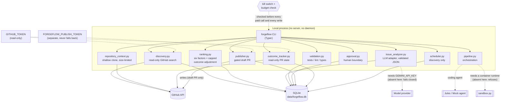
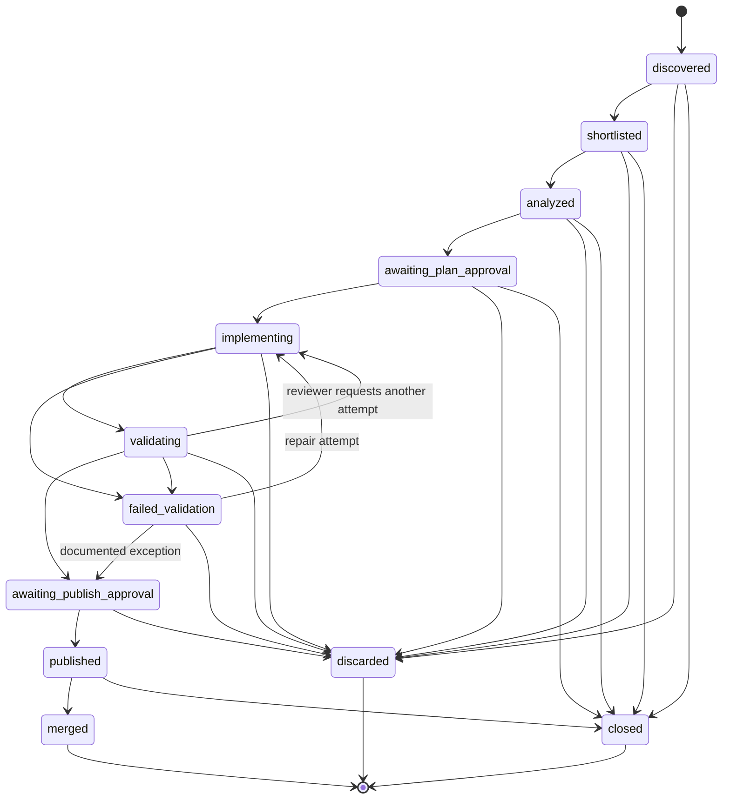
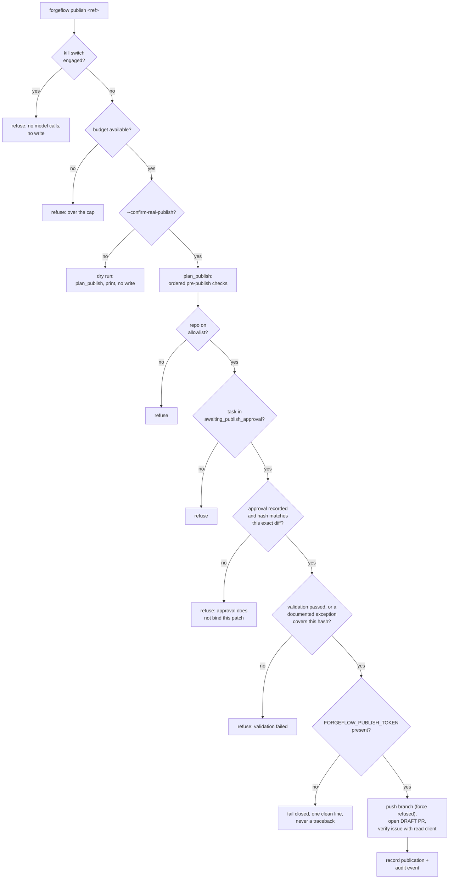
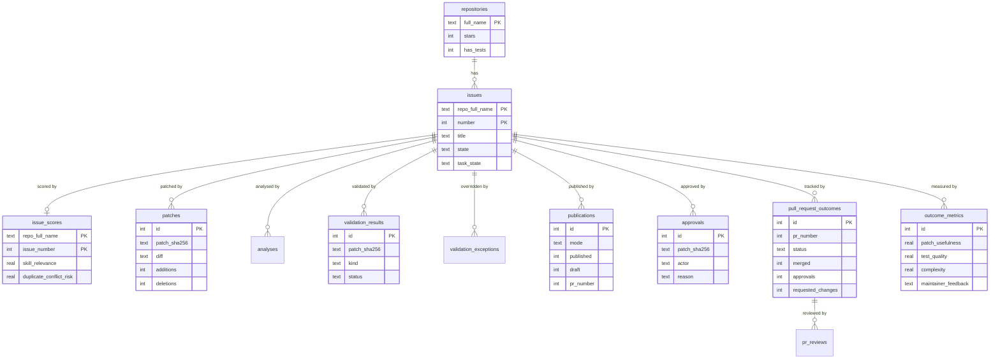

# Architecture

ForgeFlow is a local-first Python tool. It discovers open issues, ranks them,
analyses the strongest candidates, implements a patch in isolation, validates it,
and — only behind an explicit human approval and a separate credential — opens a
draft pull request. Everything is recorded in SQLite, and every step that could
write to GitHub is gated.

This document shows the system as it is built, not as it is hoped to be. Where a
capability is refused in this environment (for example, running untrusted code
with no container runtime), the diagram says so.

## System overview

The read path and the write path use different credentials on purpose. Discovery,
context, analysis, and outcome tracking use the read-only `GITHUB_TOKEN`;
publishing is the only thing that uses `FORGEFLOW_PUBLISH_TOKEN`, and that token
never falls back to `GITHUB_TOKEN` (a test asserts it).

## Task state machine

SPEC section 10 names the states. Transitions are declared in
`models.LEGAL_TRANSITIONS` and enforced by `storage.transition_task_state`, so an
illegal jump raises rather than silently moving a task.

Terminal states are `merged`, `closed`, and `discarded`. Every non-terminal state
can be discarded or closed, because a human may abandon a task at any point.

## Approval and publishing flow

This is the guarded part. Publishing is the only external write, and it happens
only after a recorded approval bound to the SHA-256 of the exact diff bytes.

Rules the flow enforces:

- **No force flag.** If the approval no longer matches the patch hash, publishing
  refuses; there is no override.
- **Draft only.** ForgeFlow never auto-merges and never force-pushes.
- **Issue verification uses the read client.** Only a verified issue lets the PR
  body claim `Fixes #N`; otherwise the reference is labelled unverified.
- **Missing token fails closed** with one clean line, and never falls back to
  `GITHUB_TOKEN`.

## Data model

SQLite, one file at `data/forgeflow.db` (gitignored). Foreign keys are enforced.
The Phase 3 tables live in their own modules so each owns its schema, but they
join on `(repo_full_name, issue_number)`.

Side tables not shown for space: `runs`, `excluded_issues`, `status_changes`,
`llm_usage`, `audit_log`, `kill_switch`, `task_guard`, `schedule_state`.

## Module responsibilities

| Module | Responsibility | Writes to GitHub? |
| --- | --- | --- |
| `github_client.py` | The only module that performs GitHub HTTP; read-only | no |
| `discovery.py` | Repository metadata and issue search | no |
| `dedupe.py` | Identity dedupe and eligibility filtering, with reasons | no |
| `ranking.py` | Six weighted factors plus a capped outcome adjustment | no |
| `repository_context.py` | Shallow clone and size-limited context extraction | no |
| `prompts.py` | Prompt construction and the injection-defence boundary | no |
| `agent_runner.py` | `CodingAgent` interface, `JulesAgent`, `MockAgent` | no |
| `issue_analyzer.py` | LLM adapter, validated output, cost cap, retries | no |
| `sandbox.py` | Container isolation, or an explicit refusal | no |
| `validation.py` | Runs the target repo's tests/lint/types | no |
| `approval.py` | Approve / request-changes / reject / discard boundary | no |
| `publisher.py` | Pre-publish checks, gated branch push, draft PR | **yes (draft only)** |
| `publish_token.py` | The publishing credential; no fallback | no |
| `diff_apply.py` | Strict unified-diff applier for the branch push | no |
| `outcome_tracker.py` | Tracks PR state; aggregates outcomes per repo | no |
| `scheduler.py` | Optional discovery-only cycle | no |
| `audit.py` | Append-only audit log | no |
| `killswitch.py` | Persistent kill switch and per-task guardrails | no |
| `security.py` | Secret scrubbing for recorded output | no |

## What is not built, and why

- **No container runtime here.** `/usr/bin/docker` exists but the daemon socket
  does not, and `podman` is absent. `sandbox.py` therefore refuses to execute
  repository code. There is deliberately **no** host-execution fallback.
- **No model keys here.** `JULES_API_KEY` and `GEMINI_API_KEY` are absent, so the
  analysis and coding-agent steps fail closed rather than pretend.
- **No background service.** The scheduler performs at most one cycle when a
  caller invokes it and the interval has elapsed; there is no daemon or timer
  thread.
